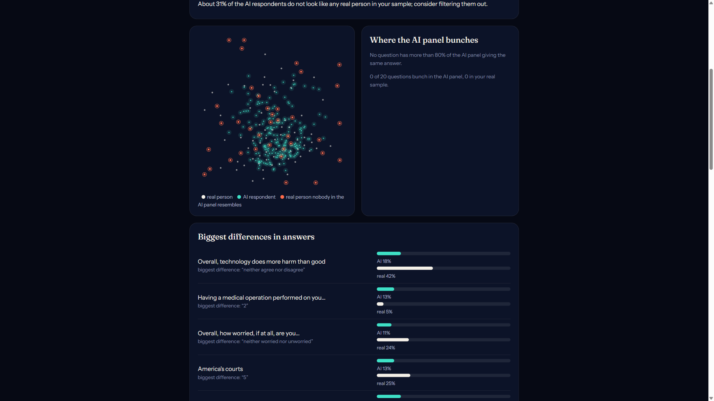

# Blindspot

**Find who your synthetic crowd leaves out.**

Teams increasingly use AI to simulate survey respondents ("synthetic panels", "silicon samples"). Blindspot audits a synthetic crowd against real survey respondents, finds the real people it cannot imagine, and tests what actually brings them back.

Built in two days for **AI Hackathon: Hack the Unreachable** (Fordham, Nov 14, 2026), Self-Improving AI track.

---

## What we found

Scored on **held-out respondents no method ever saw** (one-time holdout run):

| | GSS 2024 (n=224) | Twin-2K-500 (n=412) |
| --- | --- | --- |
| Real people covered by a Claude crowd | **63%** | **35%** |
| ...by GPT-4.1-mini digital twins (built from each person's own 500 answers) | n/a | **35%** |
| ...by randomly shuffled real answers | 85% | 60% |
| ...by a simple statistical model fitted on **25 real people** | **85%** | n/a |
| ...by other real people (ceiling) | 98% | 98% |

1. **AI crowds look real but miss a third to two thirds of real people.** Claude's synthetic people look 100% realistic, yet no one in the crowd answers like 37% (GSS) to 65% (Twin) of real respondents.
2. **Every AI-only crowd we tested covered fewer people than shuffled answers.** Three generators (Claude Haiku 5.5, GPT-4.1-mini twins, Flashpoint's synthetic panel), two national surveys. This matches recent findings that LLM-simulated respondents match answer shares but not respondents (Kumagae & Kaneko, 2026). One exception on the test split: Opus 5.5's random answers tie shuffled answers on all 24 GSS items (0.746 vs 0.740), though not on the 20 live items (0.778 vs 0.823); see point 4.
3. **They fail in three different ways.** Claude's typical answers are too alike (35% of GSS questions have over 80% of synthetic people on one answer; real people: 0%). Claude's random answers have the right spread but incoherent combinations. Flashpoint's panel has realistic spread but combines answers about as well as shuffling.
4. **Bigger models are more alike, not more diverse.** On the GSS test split (20 live items), Claude's typical answers put more than 80% of people on one answer in 30% of the questions with Haiku 5.5, 45% with Opus 5.5 and 55% with Sonnet 5.5 (real people: 0%). Opus's typical answers cover 70% of real people, still below shuffled answers (82%); Sonnet's cover 50%.
5. **Prompting cannot teach the AI the people it misses.** We tried five repairs: teaching Claude written archetypes of missed people, verified recipes, picking the best of 50 AI drafts per person, mixing models, and adding Flashpoint's panel to the candidate pool. The best (picking from 50 drafts, using real people as a filter) reached 82%.
6. **A few real people beat all of it.** A Gaussian copula fitted on just 25 real respondents covers 85% of held-out people; on 50, 89%. On the test split, selecting drafts from Opus 5.5 with only those 25 real people as the filter ties statistics on coverage (0.807 vs 0.815, seed ranges overlap) with higher realism (precision 0.98 vs 0.87); with Haiku 5.5 (0.699) or Sonnet 5.5 (0.775) it falls short.
7. **The misses are not random.** On the test split, the Claude crowd covered 47% of people with household income under $30k versus 80% of those over $110k (and 59% of women vs 70% of men). Many intervals overlap; read this as a pattern worth checking, not proof.

## How "missing" is measured

Each person is their full set of answers. Distance between two people is a Gower distance over the survey items, with each question family weighted equally. A real person is **covered** if at least one synthetic person is at least as close to them as their 5th most similar real person (the k-NN coverage metric from Naeem et al., 2020). **Precision** is the share of synthetic people who fall inside some real person's neighbourhood, i.e. look like a plausible real person. Results hold at k = 3, 5 and 10, and with unweighted distance.

## The product idea

A coverage check every synthetic panel should ship with:

1. Plug in a synthetic panel from any vendor.
2. Add a small real sample (25–100 people) on the same questions.
3. Get a Blindspot report: coverage, precision, who is missing (by answer pattern and by group), and how the panel fails.
4. Get the fix that works on your data, with the evidence. In our tests that fix was a model fitted on the small real sample, not a better prompt.

This fits the "synthetic first, escalate to real" workflow: Blindspot tells you when synthetic is enough and whom to ask when it is not.

## Use it

Open `/audit` (the "Audit your panel" button at the top of the story). No account, no install, nothing stored: your files are read in memory and forgotten.

1. **Upload** your AI panel (CSV, from Flashpoint or any tool) and a small real sample (CSV, 25–500 people, 100 or more is best). Or press "Try it with sample data" (a Flashpoint panel and 100 random GSS respondents).
2. **Match**: Blindspot pairs the question columns by header (small spelling differences are fine), shows the answer options it found, and ignores ids, timestamps and other metadata automatically (it tells you which). Untick anything you want left out.
3. **Report**: the share of real people your panel misses, how many AI respondents look realistic, a map, questions where the AI panel bunches on one answer, the five biggest differences in answers, three missed real people next to their closest AI person, and a plain-words recommendation. Download it as one self-contained HTML file, or download a repaired crowd (your panel plus statistical augmentation fitted on your real sample; clearly labelled as containing real-respondent information).



How accurate is it with a small real sample? We checked on the GSS: 20 draws each of 25, 50, 100 and 200 real people, three AI crowds, compared with the same crowd's true coverage on 334 held-out real people. The typical error of the missed-% is about ±15 points at 25 people, ±11 at 50, ±5 at 100 and ±5 at 200, so the report shows the expected error for your sample size and warns below 100 people. The "looks realistic" number reads low with small samples and is shown with its own error. Full tables: [results/audit_validation.md](results/audit_validation.md). Limits: 5 MB per file, 5,000 rows, 100 columns; the endpoint is rate-limited. The engine is `blindspot/audit/` (numpy only, no pandas); files are posted as JSON text, not multipart, so nothing is ever spooled to a temp file.

## What's in the repo

```
blindspot/data        loaders for Twin-2K-500 and GSS, item selection
blindspot/space       family-weighted Gower distance, 2-D maps
blindspot/coverage    coverage, precision, bootstrap CIs, k sensitivity
blindspot/generators  baselines (shuffled answers, Gaussian copula, other real people),
                      Claude personas (cached), Flashpoint synthetic panel loader
blindspot/agent       the repair loops we tried (kept for transparency)
blindspot/eval        experiments 0–2, bake-off, H4c/H4d, Flashpoint audit, final holdout
blindspot/api, web    the demo: story, live "can the AI imagine you?" phone page, stage view
results/              every experiment's tables (.md) and numbers (.json)
docs/                 data notes, metrics, Flashpoint notes, project context
handovers/            the step-by-step build specs, including the ones that failed
```

## Run it

```powershell
python -m venv .venv; .\.venv\Scripts\Activate.ps1
pip install -r requirements.txt
# put the datasets in data/raw/ (see docs/DATA.md), add ANTHROPIC_API_KEY to .env
python -m blindspot.data.inspect
python -m blindspot.eval.experiment0      # no API calls
python -m blindspot.eval.experiment1      # cached Claude crowd (~$0.25 first run)
uvicorn blindspot.api.main:app --port 8000   # demo at http://localhost:8000
```

## Method and honesty notes

- **Splits:** each dataset is split once (seed 42) into pool (50%, used for fitting and filters), test (30%, used while developing) and holdout (20%, scored once at the end).
- **No copying:** synthetic crowds never contain real answer rows unless a method is explicitly labelled as including real respondents; a near-duplicate check is reported for every crowd.
- **Failures are reported:** two agent designs that tried to teach Claude the missing people did not improve coverage. Their code, specs and results are in the repo.
- **Twin persona leak avoided:** Twin-2K-500 persona text contains retest answers; it never enters any prompt.
- **Flashpoint panel:** uncalibrated; gender × age and education matched to the test set, race, income and geography generated by Flashpoint. Its two holdout panels scored 0.759 and 0.674, so run-to-run variation is real.

## Limitations

- Two US surveys with multiple-choice questions. Open-ended answers and other countries are untested.
- Coverage is one reasonable definition of "missing"; others exist.
- The fix needs a small real sample. That is the point, but it is not free.
- Most Claude crowds used Claude Haiku 5.5; Sonnet 5.5 and Opus 5.5 were tested on GSS only, on the test split (experiment 1b).

## Data and references

- Twin-2K-500: Toubia et al. (2025), CC BY 4.0. https://huggingface.co/datasets/LLM-Digital-Twin/Twin-2K-500
- General Social Survey 2024 (Davern, Bautista, Freese, Herd and Morgan, General Social Survey 1972-2024). The General Social Survey (GSS) is a project of the independent research organization NORC at the University of Chicago, with principal funding from the National Science Foundation. https://gss.norc.org
  The demo serves 334 anonymous GSS test-split answer vectors (20 items, encoded, no ids) so visitors can be scored live.
- Kumagae & Kaneko (2026), *Silicon Samples Match the Answers but Not the Respondents*, arXiv:2610.30900.
- Naeem et al. (2020), *Reliable Fidelity and Diversity Metrics for Generative Models*, ICML.
- Argyle et al. (2023), *Out of One, Many: Using Language Models to Simulate Human Samples*, Political Analysis.
- Synthetic panel: Flashpoint.AI (https://flashpoint.ai), the hackathon's research platform.

Raw data is not redistributed here; see `docs/DATA.md` to download it.

## Credits

Koushik Vasa ([koushikvasa.github.io](https://koushikvasa.github.io)). Built with Claude (Anthropic) and Claude Code.

License: MIT
